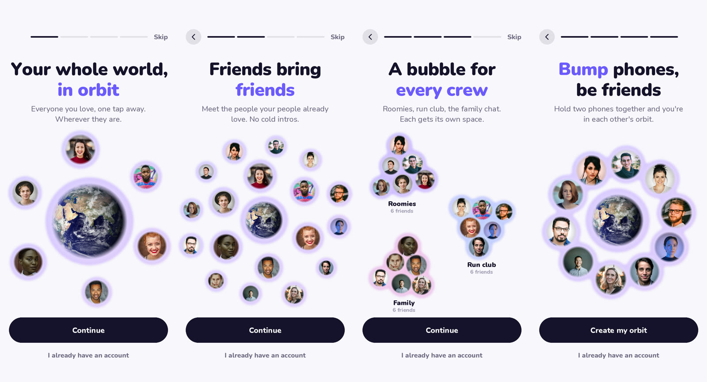

# Orbit: liquid bubble onboarding

A SwiftUI onboarding for **Orbit**, a friend-circle app in the spirit of Bump and Snapchat.
Earth sits in the middle; friends bud out of it like liquid, then friends of friends pop out of
each friend, the bubbles regroup into crews, and finally fuse into a slowly orbiting ring.

[`docs/onboarding-preview.mp4`](docs/onboarding-preview.mp4) is a motion preview rendered from the
real animation engine's output. It uses Nunito as a stand-in for SF Pro Rounded and approximates
SwiftUI's blur, so expect small differences from the simulator.

## Run it

Open `Orbit.xcodeproj` in Xcode 16 or later and run on an iOS 17+ simulator or device.
There are no dependencies. Onboarding plays on every launch, and "Replay onboarding" on the
last screen starts it again.

## How the liquid works

- **Goo** (`Bubbles/BubbleStage.swift`, `GooLayer`): every bubble draws a slightly larger circle
  into a `Canvas` layer that is blurred and then cut back with `alphaThreshold`. Where two blurs
  overlap they fuse, which is the liquid neck you see when a bubble pops free. The blob is filled
  with a periwinkle → lavender → pink gradient, crews glow in their own tint, and the whole layer
  is feathered so there is no hard outline.
- **Motion** (`Bubbles/BubbleEngine.swift`): each bubble is a pure function of time driven by
  closed-form springs, so interrupting a transition never jumps. A hidden bubble rides inside its
  parent every frame, which is why new friends bud out of a moving parent rather than out of thin air.
- **Choreography** (`Bubbles/OrbitChoreography.swift`): the layouts for each page, in a fixed
  372 × 400 reference space that scales to the screen.

Reduce Motion swaps the springs for quick, non-bouncy ones and turns off the idle wobble and the
spin. Each pop plays a soft haptic.

## Make it yours

- **Copy**: `Onboarding/OnboardingStep.swift` (title, accent phrase, subtitle, scene per page).
- **Colors**: `Theme/Theme.swift` and the `GooTint` palette in `Bubbles/BubbleEngine.swift`.
- **Photos**: replace `friend-1` … `friend-18` in `Assets.xcassets`. A missing photo falls back to
  initials.

## Credits

- Earth: NASA Goddard Space Flight Center, "Blue Marble" (public domain).
- Portraits: [Unsplash](https://unsplash.com/license), free to use under the Unsplash License.
